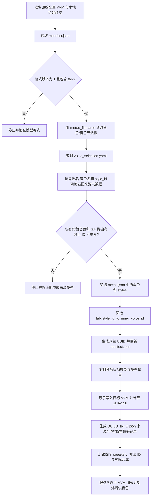

# 从全量 VVM 构建四角色模型包

本文说明如何从 VOICEVOX Core 的原始全量 VVM 中选出指定角色和音色，更新 VVM 内部元数据与 talk 路由，并生成可由本项目 WSS 服务使用的派生 VVM。流程以本目录的 `rebuild_models.py`、`voice_selection.yaml` 和 `assets/models/BUILD_INFO.json` 为准。

## 先明确抽取范围

本流程筛选的是 VVM 对外登记的角色、音色元数据和 talk style 路由。每个输出 VVM 内的共享模型权重、推理图和其他非元数据归档成员会从原始文件原样复制。因而：

- `get_speakers` 和合成 API 只会暴露选中的音色。
- 未选中的角色/音色元数据与其 talk 路由会从派生模型移除。
- 模型权重不会按音色筛小，也不能据此宣称权重内部已删除其他角色信息。
- 不同来源 VVM 对应不同权重文件，不能简单拼成一个 VVM。应保留各自来源模型并分别构建。

## 流程图



## 文件与职责

| 文件 | 构建流程中的职责 |
|---|---|
| `voice_selection.yaml` | 唯一的选择映射，声明每个来源 VVM 及保留的角色、音色和原始 style ID |
| `rebuild_models.py` | 校验来源 VVM 和选择映射，生成更新后的元数据、路由、UUID 与构建报告 |
| 原始 `*.vvm` | VOICEVOX Core 格式的 ZIP 容器，包含 manifest、角色元数据、模型权重及其他成员 |
| `assets/models/*.vvm` | 服务实际加载的派生 VVM |
| `assets/models/BUILD_INFO.json` | 来源与派生文件哈希、模型 UUID、所选音色、未改变权重哈希等来源记录 |
| `tests/test_four_voices.py` | 检查四音色清单、有效 WAV 合成、未选 ID 拒绝及模型重建约束 |

正常服务运行只需要派生 VVM；重建时才需要原始全量 VVM。

## 配置角色与来源模型

先检查来源文件名和可用角色音色。VVM 是 ZIP 容器，可用 Python 标准库只读查看 manifest 与其指向的元数据：

```bash
python3 - <<'PY'
import json
from pathlib import Path
from zipfile import ZipFile

path = Path("/path/to/original/models/0.vvm")
with ZipFile(path) as model:
    manifest = json.loads(model.read("manifest.json"))
    print("manifest:", json.dumps(manifest, ensure_ascii=False, indent=2))
    metas = json.loads(model.read(manifest["metas_filename"]))
    for speaker in metas:
        for style in speaker["styles"]:
            if style.get("type", "talk") == "talk":
                print(speaker["name"], style["name"], style["id"])
PY
```

把选择写入 `voice_selection.yaml`。每项必须匹配来源元数据中的**角色名、音色名和原始 `style_id`**。未指定音色时，应先从来源 `metas.json` 确认该角色第一个音色，再明确写入映射；脚本不会猜默认音色。

当前四角色配置示例：

```yaml
models:
  - source_vvm: "0.vvm"
    voices:
      - name: "四国めたん"
        style: "あまあま"
        style_id: 0
      - name: "春日部つむぎ"
        style: "ノーマル"
        style_id: 8
  - source_vvm: "1.vvm"
    voices:
      - name: "冥鳴ひまり"
        style: "ノーマル"
        style_id: 14
  - source_vvm: "8.vvm"
    voices:
      - name: "WhiteCUL"
        style: "たのしい"
        style_id: 24
```

可把同一个来源 VVM 中的多个角色列在同一 `models` 项下。每个来源文件只应列出一次。多个来源文件的 style ID 必须全局不重复。`source_vvm` 只接受单个 `.vvm` 文件名，不接受带目录的路径。

## 生成派生 VVM

在 Apple Silicon macOS 项目环境下，依赖创建好后从子项目根目录运行：

```bash
cd vv_tts_ws_server_four_voices
.venv/bin/python rebuild_models.py
```

默认来源目录是相邻的 `vv_tts_ws_server/assets/models`，默认输出目录是 `vv_tts_ws_server_four_voices/assets/models`。也可以显式指定来源目录、输出目录和选音配置：

```bash
.venv/bin/python rebuild_models.py \
  --source-dir /absolute/path/to/original/models \
  --output-dir /absolute/path/to/derived/models \
  --selection /absolute/path/to/voice_selection.yaml
```

来源目录必须与输出目录不同。输出目录中如果有配置未声明的额外 `.vvm`，脚本会拒绝继续，以免把旧模型误当成本次结果。使用自定义输出目录时，构建报告也写在该目录下。

## 脚本如何改写 VVM

对 `voice_selection.yaml` 中的每一个来源文件，脚本按以下顺序处理：

1. 打开来源 VVM，读取根目录 `manifest.json`，要求 `vvm_format_version` 为 `1` 并包含 `talk`。
2. 按 manifest 的 `metas_filename` 读取角色元数据，验证配置中的角色名、音色名和 style ID 与来源完全相符。
3. 验证 talk 路由 `talk.style_id_to_inner_voice_id` 中存在每一个被选中的 style ID，并拒绝跨文件重复 ID。
4. 深拷贝元数据，仅留下命中的角色和该角色被选择的 talk styles；没有保留音色的角色从元数据列表移除。
5. 从 talk 路由中仅留下选中 style ID 对应的 `inner_voice_id` 映射。
6. 更新 manifest 中的模型 UUID。派生 UUID 由来源 UUID、来源文件 SHA-256 和所选 style ID 稳定生成；来源变化或选择变化会得到不同 UUID。
7. 将新 manifest 和元数据写回相同归档路径；所有其他 VVM 成员（包括共享模型权重）直接从原始归档复制。脚本计算这些未改成员的 SHA-256，用于报告权重未变。
8. 先写入目标目录中的临时文件，再用原子替换生成最终 VVM；成功完成后写出 `BUILD_INFO.json`，记录来源/输出哈希及所选映射。

派生文件沿用各自来源文件名，但 UUID 已更新。不要把同名来源全量 VVM 复制覆盖到运行目录。

## 构建后的检查

首先检查 `BUILD_INFO.json` 中的 `voices`、`source_sha256`、`output_sha256`、`model_uuid` 和 `unchanged_weight_sha256`。修改选择配置后，应确认报告的音色列表与预期一致。

运行自动化测试：

```bash
.venv/bin/python -m unittest discover -s tests -v
```

测试会加载派生模型并验证 API 可见音色严格为 style ID `0`、`8`、`14`、`24`，四种声音均可合成有效 WAV，未选择的 ID 会被拒绝；同时会覆盖重建输入校验与共享权重保留。

也可通过已运行服务验证 WSS 音色清单：发送 `{"type":"get_speakers"}`，应只得到四个角色、每个角色一个 talk 音色。实际合成请求中 `speaker` 使用原始 style ID。

## 更新部署与回滚

确认构建和测试通过后，将派生 VVM 与其 `BUILD_INFO.json` 一起放入运行配置指向的模型目录（默认 `assets/models/`），然后重启服务。`local_engine.py` 在启动时扫描目录中所有 `*.vvm` 并从其元数据构造 speaker 列表，因此部署目录不要混放原始全量 VVM、旧派生 VVM 或来源目录中的其它模型。

如果服务仍暴露额外音色，先检查 `assets/models/` 的实际 VVM 清单以及 `get_speakers` 响应；常见原因是部署时混入了旧的全量模型，或替换了错误目录。回滚时恢复之前成套保存的派生 VVM 和对应 `BUILD_INFO.json`，再重启服务。

## 使用与再分发

派生模型仍包含原始权重，因此继续遵守原角色音色和模型提供方的使用条件。再分发前检查各角色 `character_info/*/policy.md`、原模型来源说明，以及 VOICEVOX Core、ONNX Runtime 和 Open JTalk 的相应许可。构建报告用于追溯文件来源和校验内容，不替代许可要求。
