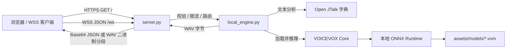

# VOICEVOX 四音色本地 WSS TTS 服务

这是一个可独立运行的 macOS ARM64 本地语音合成子项目。它将 VOICEVOX Core 0.17.0、ONNX Runtime、Open JTalk 日语词典、三个裁剪后的 VVM 模型和浏览器测试页面放在同一目录中，由 Python HTTPS/WSS 服务统一提供。日常运行不依赖父目录中的其他项目，也不需要联网下载运行时依赖。

本版本只公开四个角色音色，并沿用 VOICEVOX 原始 style ID：

| 角色 | 音色 | `speaker` / style ID | 模型文件 |
|---|---|---:|---|
| 四国めたん | あまあま | 0 | `assets/models/0.vvm` |
| 春日部つむぎ | ノーマル | 8 | `assets/models/0.vvm` |
| 冥鳴ひまり | ノーマル | 14 | `assets/models/1.vvm` |
| WhiteCUL | たのしい | 24 | `assets/models/8.vvm` |

## 运行逻辑



1. `start.sh` 确认当前平台为 macOS ARM64，并在首次启动时使用 Python 3.13 创建 `.venv`。
2. 脚本通过 `assets/wheels/` 离线安装 `requirements.txt` 所列依赖，然后执行 `server.py`。
3. 服务读取 `config.yaml`，加载本地 Core 动态库、Open JTalk 字典及 `assets/models/*.vvm`，并从模型元数据汇总说话人和音色列表。
4. HTTPS 与 WSS 共用 `127.0.0.1:8767`。`GET /` 返回 `index.html`，WebSocket API 使用 `/ws`。
5. 每个合成请求按 style ID 查找对应 VVM。模型首次被使用时才加载；合成在工作线程执行，避免阻塞 asyncio 事件循环。引擎用锁保护 Core 的模型加载和合成调用。
6. 普通合成返回一个完整 WAV。分段接口先完成整段合成，再将 WAV 按时长切为多个自包含 WAV 块并依次发送，因此这是**分段传输/播放**，不是模型端逐字生成的实时流式推理。浏览器端会对分段播放做边界处理；相关爆音诊断见 [`SEGMENTED_PLAYBACK_DIAGNOSIS.md`](SEGMENTED_PLAYBACK_DIAGNOSIS.md)。

## 项目组成

| 路径 | 作用 |
|---|---|
| `start.sh` | 平台检查、创建虚拟环境、离线安装依赖并启动服务 |
| `server.py` | HTTPS 页面服务、WSS 连接管理、请求校验、限流、完整/分段合成协议 |
| `local_engine.py` | VOICEVOX Core 初始化、模型元数据扫描、按需加载模型、音频合成和 WAV 切段 |
| `index.html` | 浏览器测试 UI，包括连接、音色选择、完整合成和分段播放 |
| `config.yaml` | 服务监听地址、TLS 文件、资产路径、分段范围、连接和速率限制 |
| `voice_selection.yaml` | 派生模型构建映射：来源 VVM、角色、音色与 style ID |
| `rebuild_models.py` | 校验选音映射并从来源模型重建仅含目标音色元数据的 VVM |
| `assets/models/*.vvm` | 本服务运行时读取的三个派生模型 |
| `assets/models/BUILD_INFO.json` | 来源和产物校验信息、UUID、音色映射及权重信息 |
| `assets/onnxruntime/` | 随项目提供的 macOS ARM64 ONNX Runtime 动态库及许可资料 |
| `assets/dict/` | Open JTalk 字典和对应许可文件 |
| `assets/wheels/` | macOS ARM64/Python 3.13 离线安装 wheel |
| `character_info/` | 四个角色的条款资料副本；当前服务推理不读取这些文件 |
| `samples/` | 四个保留音色的示例 WAV |
| `tests/` | 音色映射、服务逻辑、模型构建和浏览器分段播放测试 |

`0.vvm`、`1.vvm`、`8.vvm` 是来源模型编号。三个模型分别承载这些音色对应的权重；构建操作裁剪元数据和音色路由，不会按音色数量裁剪共享权重。运行时目录中的 VVM 是派生文件，不能用来源目录同名文件替换，否则可能重新暴露额外音色。

## 环境与启动

要求：

- macOS ARM64（Apple Silicon）
- Python 3.13（`python3.13` 命令可用）
- OpenSSL 命令行工具（macOS 通常已提供）

启动：

```bash
cd vv_tts_ws_server_four_voices
./start.sh
```

脚本自动创建 `.venv/`，并从本地 wheel 安装依赖。成功启动后访问：

- 测试页面：<https://127.0.0.1:8767/>
- WSS：`wss://127.0.0.1:8767/ws`

首次启动时，如果 `certs/localhost.crt` 与 `certs/localhost.key` 都不存在，服务会通过 OpenSSL 生成有效期 365 天、包含 `localhost` 和 `127.0.0.1` SAN 的自签证书，并将私钥权限设为仅当前用户可读写。浏览器首次访问时需要接受该本地证书；证书不会提交到 Git。若只存在证书或只存在私钥，服务会报错，需删除不完整的一侧后重启，或成对放入证书和私钥。

按 `Ctrl+C` 停止。开发调试日志可运行：

```bash
.venv/bin/python server.py --debug
```

默认只监听回环地址 `127.0.0.1`，供本机浏览器和本机程序使用。若修改为局域网监听，需要自行配置可被客户端信任的 TLS 证书及网络访问控制。

## WSS 消息协议

客户端发送 JSON 文本帧，响应也以 JSON 文本帧返回，除分段音频数据本身使用二进制帧外。请求可提供 `request_id` 用于关联响应。

### 获取音色列表

```json
{"type":"get_speakers"}
```

响应为 `{"type":"speakers","data":[...]}`，只包含上表四个角色及其一个 talk 音色。

### 完整合成

```json
{
  "type":"synthesize",
  "request_id":"demo-1",
  "text":"こんにちは。",
  "speaker":24,
  "params":{"speedScale":1.0,"pitchScale":0.0,"intonationScale":1.0,"volumeScale":1.0}
}
```

成功响应形如 `{"type":"audio","request_id":"demo-1","data":"<base64 WAV>","format":"wav","sampleRate":24000,"duration_ms":...}`。省略 `speaker` 时默认使用 ID 0（四国めたん「あまあま」）。支持的合成参数是 `speedScale`、`pitchScale`、`intonationScale` 和 `volumeScale`；具体数值由 VOICEVOX Core 校验。

### 分段传输

```json
{
  "type":"stream_synthesize",
  "request_id":"demo-2",
  "text":"こんにちは。これは分段播放の確認です。",
  "speaker":8,
  "params":{"segmentLength":0.3}
}
```

服务依次发送：

1. JSON `stream_start`，包含采样率、WAV 格式和实际分段时长。
2. 多个二进制帧，每帧是带 WAV 文件头的独立 PCM WAV 片段。
3. JSON `stream_end`，包含 `total_chunks`、`total_bytes` 和耗时。

`segmentLength`（秒）会被限制在配置的最小值和最大值之间，默认 0.3 秒。客户端需按 `request_id` 识别当前流，并把每个二进制块作为完整 WAV 片段解码/播放。分段传输结束后才获得最终合成结果，不能降低 Core 完成整句合成的等待时间。

### 心跳与错误

- `{"type":"ping"}` 返回 `{"type":"pong","timestamp":"..."}`。
- 未知消息类型、无文本、超长文本、未登记的 speaker/style ID、速率超限及合成失败会返回 `{"type":"error","message":"...","timestamp":"..."}`；若请求带有 `request_id`，错误响应会带回该 ID。

## 运行配置与模型重建

`config.yaml` 是运行时配置：默认监听 `127.0.0.1:8767`，最大文本长度 500 字符，最大连接数 1000，速率限制为每连接 5 次/秒、突发 10 次；分段长度默认 0.3 秒，范围 0.1–1.0 秒。配置文件中的目录相对项目根目录解析。

`voice_selection.yaml` 仅由 `rebuild_models.py` 使用，服务运行时通过 VVM 的元数据读取可用音色，不会读取这个选音配置。重建时需要可用的来源模型，默认来源位置为相邻的 `vv_tts_ws_server/assets/models`：

```bash
.venv/bin/python rebuild_models.py
```

也可以指定来源目录：

```bash
.venv/bin/python rebuild_models.py --source-dir /absolute/path/to/original/models
```

脚本会先校验配置和来源模型元数据，再输出派生 VVM 与 `BUILD_INFO.json`。重建后重启服务以重新加载元数据。生产运行只需要本目录里的派生模型，不要求保留来源模型目录。

## 测试与排查

运行 Python 测试：

```bash
.venv/bin/python -m unittest discover -s tests -v
```

浏览器分段播放测试（如果已安装 Node.js）：

```bash
node --test tests/test_playback.cjs
```

常见情况：

- **启动提示平台或 Python 版本不支持**：确认是 Apple Silicon macOS，并且 `python3.13` 在 `PATH` 中。
- **TLS 文件缺失或加载失败**：确认 `certs/` 下证书和私钥成对存在；本地开发可删除损坏的一对后重启以重新生成。
- **Core 找不到运行库、字典或模型**：确认 `assets/` 目录完整，且 `assets/models/` 内是派生的三个 VVM。
- **浏览器提示不安全或 WSS 连接失败**：先打开 HTTPS 测试页面并接受本地自签证书，再连接 WSS。
- **服务返回未知 style ID**：用 `get_speakers` 获取本版本支持 ID；合法值为 `0`、`8`、`14`、`24`。
- **分段边界听到爆音**：参阅 [`SEGMENTED_PLAYBACK_DIAGNOSIS.md`](SEGMENTED_PLAYBACK_DIAGNOSIS.md)，确认浏览器端使用当前 `index.html` 的播放边界处理逻辑。

## 许可与使用说明

VOICEVOX 角色音色、VOICEVOX Core、ONNX Runtime 和 Open JTalk 字典各自适用不同条款。使用前请检查 `character_info/*/policy.md`、`assets/onnxruntime/TERMS.txt`、`assets/onnxruntime/third-party-notices.html`、`assets/dict/open_jtalk_dic_utf_8-1.11/COPYING`，以及 VOICEVOX Core 对应发行版的许可。示例音频和角色模型的使用需遵守角色及模型提供方的使用条件。

本仓库面向本机测试和集成。模型、字典及运行库以独立二进制资产形式随仓库提供；如果再分发，请一并保留其许可和来源信息。
