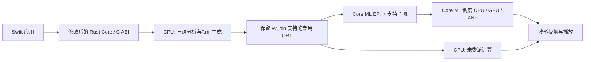

# VOICEVOX 在 iPhone 上适配 ANE：额外改动与优化分析

日期：2026-10-24（Asia/Shanghai）。对象：当前 `vv_tts_server` 使用的 Talk VVM、VOICEVOX Core 0.17.0、专用 ORT；ORT Core ML 实现细节以微软 ORT v1.23.2 为核查基准。AI Reader 当前最低部署版本为 iOS 17。

本文补充[原可行性报告](2026-10-24-iphone-local-tts-feasibility.md)第 9 章。依据公开源码、Apple 文档和此前 macOS CPU 基线分析；**没有进行模型转换、iPhone/ANE 实测，也没有修改运行代码或模型。** 源码与文档核查索引见 [ane-inspection.json](evidence-2026-10-24/ane-inspection.json)。

## 1. 核心判断

**ANE 适配可以作为独立工程推进，但前提是获得能加载现有模型的 Core ML 后端，或取得可转换模型。去掉 Python 并不能解决这一步。** 工作包含后端接入、动态长度、算子覆盖、数值一致性和移动端资源管理，不能视为修改一个运行设备参数。

建议先让 **CPU 保留日语前端、时长/音高预测和特征展开，只尝试加速重型 decode**。此前 Mac 基线中，28 字样本查询约 0.845 ms，synthesis 约 797 ms；这支持优先研究合成阶段，但尚未把 synthesis 内部的特征展开、decode、波形包装分别计时，不能把 797 ms 全部当作独立 decode 耗时，也不能推算 iPhone 倍数。

应把工作分为两个层次：

| 层次 | 必须解决的问题 | 完成标志 |
|---|---|---|
| 接通并保证正确 | 模型/运行库来源、Core 后端入口、张量契约、系统兼容、CPU 回退、缓存隔离 | 同一音色和输入能可靠产出正确波形，能解释实际设备分配 |
| 在正确基础上优化 | 长度策略、图改写、FP16/量化、内存复用、预热和调度 | 真机首段延迟、RTF、内存及持续功耗优于 CPU 基线 |

不要求一开始将全图放进 ANE。先确认主要计算是否得到有效加速，再决定继续投入图改写或量化。

## 2. 两条路线及所需改动

### 2.1 路线 A：专用 ORT 增加 Core ML Execution Provider



这条路线保留 VVM 和现有特征接口，适合首先与上游确认。**若上游能提供同时支持 `vv_bin` 和 Core ML EP 的 iOS 运行库，就可以先做分图实验，不一定要先取得训练源模型。** 当前公开 builder 会转向专用生产源码，不能把普通微软 ORT 加 `--use_coreml` 当作兼容替代品。[1][2]

需要修改或核实以下位置，路径均为 Core 0.17.0 上游源码路径：[1]

| 位置 | 现状 | 适配工作 |
|---|---|---|
| `core/devices.rs` | CPU；GPU 仅 CUDA/DirectML | 增加 Apple 后端选择、能力查询和不可用原因 |
| `core/infer/runtimes/onnxruntime.rs` | Session 仅注册 CPU/CUDA/DirectML | 注册 Core ML EP，配置模型格式、计算设备、缓存和诊断 |
| `synthesizer.rs` 的 Session 配置 | 时长/音高走 CPU，decode 走重型设备 | 保留这种分工，将 Talk decode 接入 Apple 后端 |
| `core/status.rs` | 加载模型时建立各操作的 Session 集合 | 管理后端、缓存目录、加载失败和 Session 生命周期 |
| C API / Swift 封装 | 公开加速模式不足以表达 Apple 配置 | 增加版本化配置/诊断接口，避免破坏既有 ABI |
| 专用 ORT iOS XCFramework | 当前发行配置未接入 Core ML | 上游提供含 EP 的兼容构建、版本与部署要求 |

Core 当前使用固定 git revision 的 Rust `ort` 绑定；需要核对该版本是否封装所需 provider options，必要时通过匹配的 ORT C API 补桥接。不能直接套用最新 crate 示例。

先比较 ORT 原始 CPU 与 Core ML `CPUOnly`，验证子图转换是否引入偏差；再比较 `CPUAndNeuralEngine`、`CPUAndGPU`、`ALL`。这些是允许的设备集合，**选择 CPU+ANE 不等于所有算子都会在 ANE 上执行**。

### 2.2 路线 B：获准源模型转为原生 Core ML

上游交付获准的源模型、受支持的转换中间表示或官方 Core ML 模型后，在开发机生成 ML Program，端侧由 Swift/Objective-C++ 调 Core ML。训练和导出工具继续使用 Python 不影响 iPhone 端去 Python。

这条路线更方便直接控制模型导出、精度和 Apple API，但还有一个容易遗漏的改动：**现有稳定 C API 没有暴露可直接替换 Talk decoder 的帧特征接口。** AudioQuery JSON 是重音/音素等结构，不是已经展开好的 `f0`、`phoneme` 张量。[1]

因此需要在 Rust Core 的“特征展开 → decode”边界增加小型 FFI，或实现内部复合后端，继续复用原有的语速、音高、语调、音色路由和前后处理。不要在 Swift 再复制一份特征生成算法，增加行为漂移风险。

还须检查加载 VVM 时是否仍创建原 CPU decoder Session。若整组原模型与 Core ML decoder 同时驻留，可能重复占用权重和工作区；需要支持按操作延迟加载或只加载前端所需预测模型。

现代 `coremltools.convert()` 不是通用 `vv_bin`/ONNX 读取器。只有权重文件、没有网络定义/合法导出路径和输入语义，仍不足以完成转换。[3]

### 2.3 应向模型/运行库提供方索取的技术交付

1. 路线 A：兼容现有 `vv_bin` 的 Core ML EP 构建，或可维护的构建支持；提供真实分图日志和最低系统版本。
2. 路线 B：获准导出的模型及转换入口、网络定义、依赖版本、目标精度；若直接提供 Core ML 模型，同时提供可复现版本和校验值。
3. 两条路线都需要：张量名称/shape/dtype、音素映射、内部 speaker ID、采样率、padding/裁剪定义、参考输入张量和对应输出波形。
4. 若计划模型分块：提供实际感受野、状态、边界/overlap 规则与验证样本；不能仅凭“卷积模型”推断可以任意切块。

这些是实施前的输入条件；本次仅核查公开资料。

## 3. 当前 decoder 的具体契约

Core 的 Talk 输入定义与调用代码可以确认：[1]

| 输入/输出 | 当前形状与类型 | 适配要点 |
|---|---|---|
| `f0` | `[N, 1]`, float32 | 长度随合成音频变化 |
| `phoneme` | `[N, 45]`, float32 | 与 f0 的 N 必须一致，保持音素编码顺序 |
| `speaker_id` | `[1]`, int64 | 使用模型内部音色 ID，不能直接假设等于外部 style ID |
| `wave` | 一维 float32 | 原生输出 24 kHz，按现有规则裁剪 |

每帧对应 256 个采样点，即 93.75 帧/秒。设特征展开后有 F 个有效帧，现有 Core 在两端**各加 38 帧**，模型输入 `N = F + 76`；模型输出按每帧 256 点对应，Core 再从两端各裁掉 `38 × 256 = 9728` 个采样点。

padding 不是所有通道都填零：`f0 = 0`，`phoneme` 的第 0 通道为 1，其余为 0。迁移必须先复现现有约定，再研究是否能缩减。源码将其标为避免声音截断的 workaround，不能为了节省计算直接移除。

特别注意：Core 另一个 `StreamingTalk` 分支中的 `MARGIN=14` 不属于当前 Talk decoder 的通用分块参数，不能用它替代上述 38 帧或据此制定分块策略。

## 4. 动态长度：iOS 17 的具体限制与优化策略

### 4.1 为什么这里不能简单使用常见的长度桶

Apple 文档规定：**iOS 18 之前，多输入模型只有一个输入能使用 `EnumeratedShapes`，其他输入必须固定；iOS 18 起允许多个输入枚举，但数量要相同，组合按枚举下标配对。** 单输入最多 128 种枚举 shape。[4]

当前 decoder 的 `f0` 和 `phoneme` 都随 N 变化，而 AI Reader 仍需支持 iOS 17。因此，不能直接将两个输入各声明为一组枚举形状就认为兼容完成。

| 策略 | iOS 17 可行方向 | 主要代价与验证 |
|---|---|---|
| 两个输入使用有界 `RangeDim` | 保留原输入结构，适合先实验 | ML Program 需要有限正上界；动态图是否有效分配给 ANE 要测 |
| 少量固定 N 的模型 | 按预测帧数选择对应模型 | 编译缓存、包体和多 Session 内存可能增长；不能全部常驻 |
| 合并为一个 `[N,46]` 输入 | 在获准导出时合并 f0/phoneme，图内再拆分；只留一个枚举输入 | 需修改图和接口，验证拆分算子、布局/拷贝和数值一致性 |
| 提高到 iOS 18+ | 可以同步枚举两个动态输入 | 会改变产品系统要求；本次不改变现有目标 |

这里的 shape 策略是**原生 Core ML 导出候选**。路线 A 的 ORT 自动转换不等于已暴露同等导出控制，具体取决于 EP 和专用 runtime 能力。使用范围输入时，应用封装仍须检查两个输入的 N 相等，不能只依靠各自的范围合法性。

`RequireStaticInputShapes=1` 只会限制可委派节点的输入 shape，并不会自动将动态模型冻结为静态图。应用层补齐张量也不等于模型声明已变静态。需要获准的静态导出、经过验证的维度覆盖或后端支持。

### 4.2 长度应按帧数控制

语速、停顿和预测时长都会影响 F；固定字符数不能可靠限制算量。先完成查询/特征长度估计，再选择满足 `B ≥ F+76` 的桶。例如 B 为 256、512、1024 时，除去现有 padding，可容纳约 1.92、4.65、10.11 秒的有效音频。**这些仅用于说明关系，不是推荐的最优桶。**

桶优化要同时控制：

- 补齐的计算浪费：短句进入大桶可能抵消 ANE 收益；超长句优先在日语韵律边界拆分或走有界回退。
- 输出裁剪：记录有效 F、左右 padding 和额外桶 padding 的位置，恢复准确输出长度，避免把补齐静音播放出去。
- 音质一致性：新增桶 padding 采用正确 silence 特征；若图含全局统计或非局部操作，额外 padding 仍可能改变有效段，必须对照验证。
- 默认与首次调用：Core ML 会为默认 shape 预分配；选择真实高频短句长度，避免把最大桶设为默认而抬高常驻内存。首次非默认 shape 的成本也要单独测。[4]

在支持的系统上可评估 `reshapeFrequency`。Apple 标注该 API 从 iOS 17.4 可用；它是在形状重用与变化频率间提供优化提示，不能无条件设为某值。核查的 ORT 1.23.2 配置只接入 specialization strategy，没有暴露 reshapeFrequency，路线 A 若需要此提示还要补后端桥接。[5][6]

## 5. 图与算子优化：目标是减少重型计算回退和设备往返

目前没有取得现有 `vv_bin` 的获准完整图，**不能断言它具体包含哪些算子、哪一层必然不支持 ANE**。取得图或 EP 日志后，按以下顺序处理：

1. 列出各操作的实际耗时、shape、dtype、委派设备与分区边界，先定位重型计算，不能只统计“支持了多少节点”。
2. 优先形成连续的大计算子图，减少 CPU/Core ML 之间的多次同步和中间张量交换；轻量 shape 操作回 CPU 不一定值得重写。
3. 对实际存在的常量运算做折叠，提前解析可确定的 shape、padding、卷积参数。若源网络含可折叠的 weight normalization 等结构，在导出前处理并验证。
4. 对实际存在的 `Transpose/Cast/Reshape/Pad/Slice/Gather` 检查冗余和分图影响，减少布局转换与往返；不能只为“算子数更少”破坏原语义。
5. 如果重型上采样/卷积无法委派，才评估等价改写或重新导出；这可能是路线 A 的上限，需要上游配合或改走路线 B。

一个具体核查例子：微软 ORT **v1.23.2** 的 `ConvTranspose` Core ML builder 要求 ML Program，权重/偏置为常量；拒绝 `SAME_UPPER/SAME_LOWER`、非零 `output_padding`、显式 `output_shape`，并对 padding 一致性有严格检查。[7] 若实际图使用这些属性，就需要改写或回退；**这并不证明当前 decoder 正好触发这些限制，也不等于 Apple 原生 Core ML 永远不支持对应计算。**

原 Core 使用 ORT Level1 图优化。不能盲升到 Level3：CPU fusion、layout 变换可能改变 EP 捕获范围。应对每个候选同时比较图分配、音质和端到端时间。

## 6. 精度优化：先验证 FP16，再决定量化

| 优化 | 建议顺序 | 条件与风险 |
|---|---|---|
| 内部 FP16 计算/权重 | 优先候选 | 降低部分存储/带宽需求；先确认原模型精度和后端实际执行方式 |
| 敏感层保留 FP32 | FP16 出现音质退化后定位 | 混合精度可能引入 cast/分图；需测是否仍有收益 |
| INT8 权重压缩 | 有包体或带宽压力时 | 压缩权重不保证整数计算，不能承诺推理同比提速 |
| INT8 权重+激活 | 新设备上的后续实验 | A17 Pro/M4 等较新硬件有相关优化潜力，需匹配系统/工具链及校准集 |
| 更低位权重、剪枝、蒸馏/QAT | 明确瓶颈后再研究 | 可能需要训练支持；不属于当前格式的直接转换工作 |

**Core 当前输入/输出类型处理接受 float32 和 int64，拒绝 float16、int32。** Talk decoder 本身输出为 float32。因此路线 A 可以优先保持外部 `f0/phoneme/wave` 的 float32 和 `speaker_id` 的 int64，仅在子图内部研究 FP16；若修改外部类型，必须同步 Rust binding、signature 和 C/Swift 边界。[1]

路线 B 可以重新定义原生 Core ML 接口，但同样要明确边界上的 cast、音色 ID 转换与输出格式。`AllowLowPrecisionAccumulationOnGPU` 是 ORT 的 GPU 选项，不能当作 ANE FP16 开关。[6]

校准/验收需覆盖各音色、语速、短长句，以及日语清浊音、无声化、促音、长音、数字/助数词、疑问句、静音和停顿。保存 NaN/Inf、幅度/削波、长度、谱误差与盲听结果；波形逐点误差只能辅助定位，不能单独决定音质是否合格。[8]

## 7. 编译与缓存：这里存在正确性风险

Core 从内存加载模型。ORT v1.23.2 在未提供模型 metadata **`COREML_CACHE_KEY`** 时，对这类模型的默认标识可能来自图输入名和节点输出名的 hash，**不保证包含权重内容**。不同 VVM 可能具有相同图名称；若共享缓存目录，就有复用错误编译结果的风险。[9]

建议在 Session 创建层按以下内容隔离 `ModelCacheDirectory`，无需为了设置 metadata 去修改保护格式：

```text
App 缓存根目录 /
  hash(模型内容 + operation + shape策略 + 精度策略 + Core/ORT/导出器版本 + EP配置) /
    Core ML EP 管理的子图与编译结果
```

至少确保不同模型内容、不同 decode 配置不会共用目录；设备/系统升级后的缓存兼容性也要记录并验证。滚动在线文档与固定版本实现可能有差异，当前核查的 metadata key 是 `COREML_CACHE_KEY`。

另外需要：

- 把首次转换、编译、模型加载和首次预测分开计时，避免把一次冷启动算成每次推理开销。
- 缓存可重建，设置空间上限、版本失效和清理规则；同一模型并发 prepare 时只允许一次构建，避免竞争读取半成品。
- 原生路线可随 App 构建预编译 `.mlmodelc`，减少端侧转换/编译工作；设备专门化和首次加载仍可能有成本。
- 只预热当前音色和高频长度；不要把所有音色、所有桶全部预热驻留。

## 8. 内存、数据路径与阅读调度

最需要控制的通常是权重、激活和多个 Session，而不是少量输入特征。两个 float32 特征输入合计每帧约 `46×4 = 184` 字节；波形每帧约 `256×4 = 1024` 字节，网络内部激活可能远大于两者，具体须实测。

建议保持一个主要合成任务串行运行，先从“当前句 + 一句预取”开始；默认只驻留当前一组模型及少量 shape。避免 CPU decoder、Core ML decoder、多个桶和多个音色的权重同时展开。需要 CPU 回退时设计按需加载/释放策略，并测回退瞬间的峰值。

复用 f0、phoneme、输出缓冲和布局，减少 Swift Array、Rust ndarray、ORT Tensor、MLMultiArray 之间的重复复制。可研究按明确 stride 包装既有缓冲，但必须保证所有权、对齐、连续布局和预测完成前的生命周期。Apple 统一内存不等于这条 API 链自动实现零拷贝。

端到端延迟应拆成：

```text
日语前端与预测 + 帧特征展开 + 补齐/类型与布局转换
  + Core ML 执行 + CPU 回退与同步 + 裁剪/格式转换 + 播放准备
```

只有其中部分时间会被 ANE 缩短。对很短的句子，启动/同步成本可能占比较高；对很长的句子，padding 和激活内存可能成为主要限制，应由测量选择 CPU 或加速后端。

分句降低首段等待、长度桶改善编译执行、神经网络按帧流式是三个不同改动。当前 Talk 模型是否能真正流式，仍需合法图的上下文/状态分析；不能将整句算完再切 PCM 当成降低模型首段延迟的方案。

## 9. 真机验证与设备策略

ANE 的可用性不取决于是否支持 Apple Intelligence。应覆盖最老计划支持的设备和较新设备，至少包含一个 A17 Pro 或更新的评估组；旧设备继续保留 CPU 路线。Metal/GPU 是独立候选，不等于 ANE。

| 对照项 | 目的 |
|---|---|
| 原专用 ORT CPU | 保留原始正确性与速度基线 |
| Core ML CPUOnly | 区分图转换偏差和加速器执行偏差 |
| Core ML CPU+ANE / CPU+GPU / ALL | 判断真实设备分配及最佳运行策略 |
| 首次安装/编译、缓存冷/热、长度切换 | 观察首段延迟与最差情况 |
| 短句、长句、不同音色/语速 | 发现 shape 和模型切换问题 |
| 持续阅读 20–30 分钟 | 测降频、温度、能耗及缓冲是否持续稳定 |

报告首个可播放 buffer 的 p50/p95、总合成耗时、RTF（合成时间/音频时长）、physical footprint/峰值、编译缓存大小和每分钟生成音频的能耗；不能只给最佳热启动样本。播放阶段另测锁屏/后台、音频中断和耳机切换。

ORT 日志能提供 partition、支持节点和总节点数，但**节点覆盖率不等于耗时覆盖率；进入 Core ML EP 也不等于实际在 ANE 执行**。结合 Core ML 计算计划和 Instruments 检查设备分配及实际执行。

Apple `MLComputePlan` 从 iOS 17.4 可用；其 cost 和设备使用是预估信息，需要配合真机时间、能耗与温控测量。ORT 1.23.2 的 `ProfileComputePlan` 也有平台/构建条件，开发分析时启用，不纳入正式预测耗时。[5][6]

## 10. 推荐实施顺序与继续投入条件

| 阶段 | 交付物 | 继续投入条件 |
|---|---|---|
| P0：明确可用输入 | 上游专用 Core ML runtime，或获准可转换模型；张量/音色/波形契约 | 确认可合法加载/导出，能维护版本 |
| P1：建立真机 CPU 基线 | Swift+C API 本地合成，分句、有界队列、按需加载；测量记录 | 最老目标机基本可用，已有音质和性能基准 |
| P2：仅接入 decode | 路线 A Session/EP 或路线 B FFI；CPU 回退与内容 hash 缓存 | 波形和音色一致，主要计算分配及回退可解释 |
| P3：解决形状与图覆盖 | iOS 17 可用的长度策略、padding/裁剪验证、少量高收益图改写 | 实际首段/吞吐或能耗改善，内存在产品预算内 |
| P4：精度与资源优化 | FP16 候选；需要时加入量化、缓冲复用、预热/清理 | 盲听和边界样本通过，持续阅读保持收益 |
| P5：形成设备策略 | 按系统/机型/输入选择后端，失败回退与版本诊断 | 冷热启动、长读、切换和系统中断稳定 |

拿不到模型或专用后端时，先完成 CPU 本地化，将 ANE 阶段明确依赖于上游交付。若重型计算大部分回 CPU、频繁设备往返导致变慢，或能耗/内存劣于 CPU，就保留 CPU 产品路线，依据具体瓶颈决定是否值得继续改图。没有实际图和真机数据前，不能承诺固定加速倍数或可靠工期。

**对本项目的优先组合是：复用 Rust Core 的 CPU 前端，争取上游支持的 Core ML decode 后端；先做正确性、iOS 17 长度策略和缓存隔离，再尝试 FP16。** 完整重写 Rust/C 推理引擎和一开始就做 INT8 都不是解决当前阻塞的最短路径。

## 11. 官方依据

- [1] VOICEVOX Core **0.17.0**：[Talk 张量签名](https://github.com/VOICEVOX/voicevox_core/blob/0.17.0/crates/voicevox_core/src/core/infer/domains/talk.rs)、[decode 与 Session 分工](https://github.com/VOICEVOX/voicevox_core/blob/0.17.0/crates/voicevox_core/src/synthesizer.rs)、[padding 实现](https://github.com/VOICEVOX/voicevox_core/blob/0.17.0/crates/voicevox_core/src/core/adjust/pre.rs)、[ORT Session/类型处理](https://github.com/VOICEVOX/voicevox_core/blob/0.17.0/crates/voicevox_core/src/core/infer/runtimes/onnxruntime.rs)、[设备枚举](https://github.com/VOICEVOX/voicevox_core/blob/0.17.0/crates/voicevox_core/src/core/devices.rs)、[模型加载](https://github.com/VOICEVOX/voicevox_core/blob/0.17.0/crates/voicevox_core/src/core/status.rs)、[音素编码数量](https://github.com/VOICEVOX/voicevox_core/blob/0.17.0/crates/voicevox_core/src/engine/acoustic_feature_extractor.rs)。
- [2] 专用运行库 [voicevox_onnxruntime-1.23.2 构建配置](https://github.com/VOICEVOX/onnxruntime-builder/blob/voicevox_onnxruntime-1.23.2/.github/workflows/build.yml)。
- [3] Apple coremltools [Unified Conversion API](https://apple.github.io/coremltools/docs-guides/source/unified-conversion-api.html)。
- [4] Apple coremltools [Flexible Input Shapes](https://apple.github.io/coremltools/docs-guides/source/flexible-inputs.html)：多输入枚举限制、默认 shape 预分配、有界输入。
- [5] Apple [MLComputePlan](https://developer.apple.com/documentation/coreml/mlcomputeplan-1w21n)、[reshapeFrequency](https://developer.apple.com/documentation/coreml/mloptimizationhints-swift.struct/reshapefrequency-swift.property)。
- [6] 微软 ORT **v1.23.2**：[Core ML provider options](https://github.com/microsoft/onnxruntime/blob/v1.23.2/onnxruntime/core/providers/coreml/coreml_options.cc)、[选项定义](https://github.com/microsoft/onnxruntime/blob/v1.23.2/include/onnxruntime/core/providers/coreml/coreml_provider_factory.h)、[编译/运行/优化提示](https://github.com/microsoft/onnxruntime/blob/v1.23.2/onnxruntime/core/providers/coreml/model/model.mm)。[在线 EP 文档](https://onnxruntime.ai/docs/execution-providers/CoreML-ExecutionProvider.html)为滚动版本，具体能力须以目标版本实现为准。
- [7] 微软 ORT **v1.23.2** [ConvTranspose builder](https://github.com/microsoft/onnxruntime/blob/v1.23.2/onnxruntime/core/providers/coreml/builders/impl/convtranspose_op_builder.cc)。
- [8] Apple coremltools [Optimization Overview](https://apple.github.io/coremltools/docs-guides/source/opt-overview.html)、[Quantization Overview](https://apple.github.io/coremltools/docs-guides/source/opt-quantization-overview.html)。
- [9] 微软 ORT **v1.23.2** [Core ML 分图与缓存 key 实现](https://github.com/microsoft/onnxruntime/blob/v1.23.2/onnxruntime/core/providers/coreml/coreml_execution_provider.cc)。
