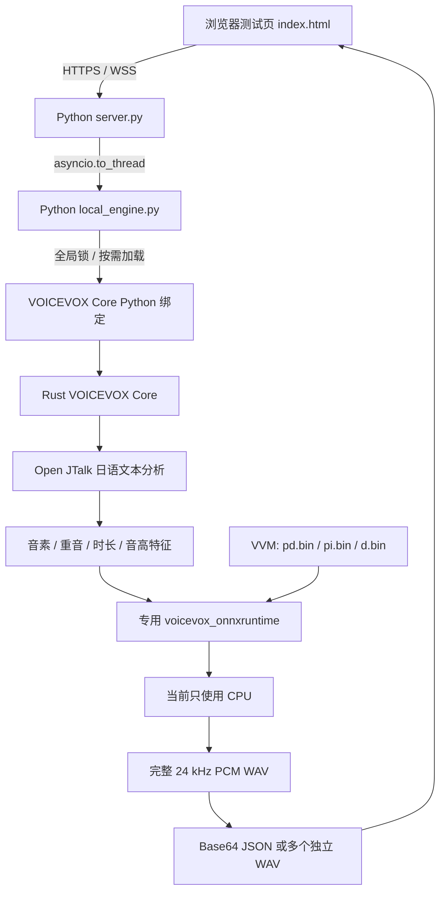
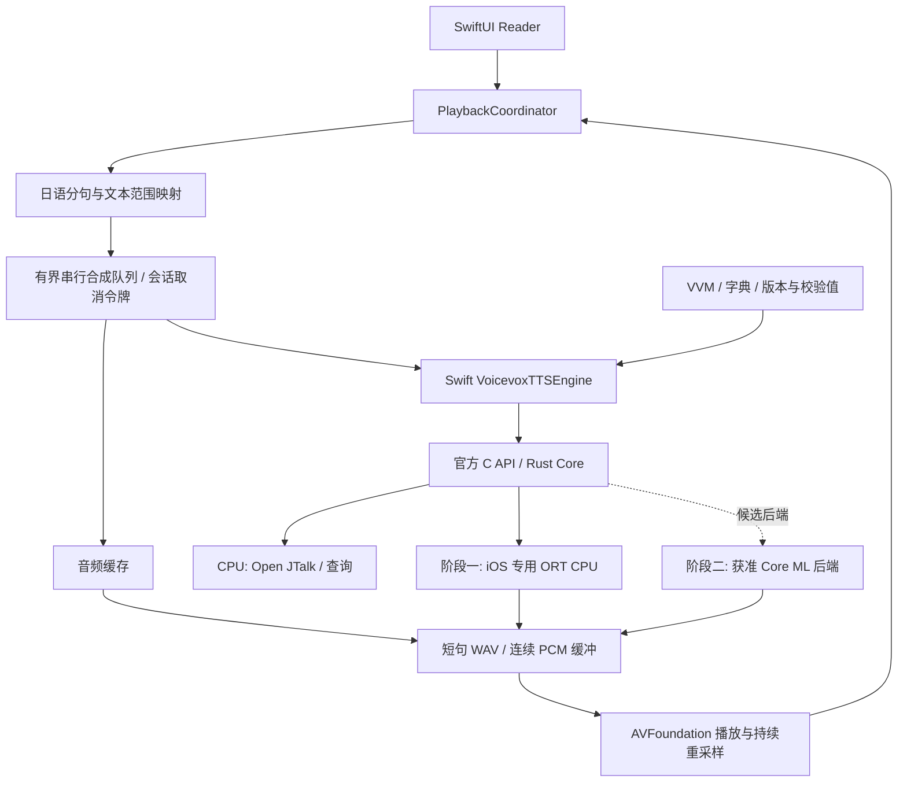

# vv_tts_server：iPhone 本地日语 TTS 引擎可行性与优化分析

日期：2026-10-24（Asia/Shanghai）  
审查对象：`/Users/rgwei/pj/pj_my/vv_tts_server`，提交 `bebbfffb163882b575a599df4359a68f047f3165`。  
关联集成对象：`/Users/rgwei/pj/pj_my/ai_reader`，当前最低部署版本 iOS 17。  
本次交付：源码与资产审查、官方发行物检查、macOS CPU 实验和迁移建议。未实施运行框架替换，未修改现有运行代码或模型。

后续专题：[ANE 适配所需额外改动与优化](2026-10-24-ane-adaptation-optimization.md)，进一步核查 iOS 17 多输入动态形状、decoder 接口、精度与编译缓存等具体问题。

## 1. 结论与建议

**可以去掉 Python，把这套日语语音能力接入 iPhone 本地应用。优先方案是 Swift 调用 VOICEVOX Core 的 C API，复用内部已有的 Rust 核心和专用 ONNX Runtime。单纯重写 Python 服务，不是当前最有证据支持的提速方向。**

目前有六个决定方案的事实：

1. **底层已经原生化。** Python 只承担 HTTPS/WSS 服务、参数处理、任务编排、数据包装；VOICEVOX Core Python wheel 内部是 Rust 扩展，模型计算交给原生 ONNX Runtime。
2. **iOS 已有官方二进制起点。** Core 0.17.0 提供 XCFramework，包含 iOS 真机和模拟器切片；专用运行库也提供 iOS XCFramework。不必为了上 iPhone 从头重写推理核心。
3. **本地运行与 ANE 加速是两个不同阶段。** 当前项目强制 CPU，上游 Core 的设备分支为 CPU/CUDA/DirectML，没有注册 Core ML。把配置改成 `GPU` 或 `AUTO` 不会自动使用 iPhone GPU/ANE。
4. **模型格式是加速路线的关键限制。** 三个 VVM 内部都是 `vv_bin`，并非可直接交给通用 ONNX Runtime 或 coremltools 的 `.onnx`。专用运行库、格式支持和许可条件必须一起考虑。
5. **眼下最大的工程收益是分句和内存控制。** 本机实验中，138 字文本使用单模型整段合成，峰值 RSS 约 912 MiB；按五句依次合成约 430 MiB。首句完成由约 4.64 秒提前到约 1.28 秒，但韵律和停顿发生变化，需要音质验证。
6. **现有“流式”不降低模型首包时间。** 服务先合成完整 WAV，再切成 0.1–1.0 秒片段。它属于分段传输，不是边生成边播放的增量模型推理。

建议决策如下：

| 方向 | 结论 | 推进条件 |
|---|---|---|
| Swift → 官方 C API → Rust Core → 专用 ORT CPU | **优先验证** | 真机测量速度、峰值内存、持续功耗；保留现有音色 |
| 再增加自有 Rust 编排层 | 可选 | 有 Android/桌面共用需求，或 Swift 之外确有复杂共享逻辑 |
| 把 Python WSS 服务改成 Rust/C 服务 | 对桌面服务可行；对 iPhone 优先级低 | 本地 App 应直接调用库，服务协议开销不是当前主要耗时 |
| 专用 ORT 增加 Core ML EP | 有潜力，**存在上游协作前提** | 保留 `vv_bin` 支持的获准运行库构建、Core 改造、算子覆盖与真机验证 |
| 授权源模型 → 原生 Core ML | Apple 平台长期候选 | 获得可转换模型和转换/再分发权限，完成数值与音质验证 |
| 用 C/Rust 从头重写模型、Open JTalk 和推理后端 | 暂不建议 | 成本和风险高，现有原生实现已经承担主要计算 |

**推荐顺序：先建立 iOS CPU 基线 → 分句、预取和单模型驻留 → 根据真机结果决定是否投资 ANE。** 如果必须保留四个 VOICEVOX 音色，优先沿用官方资产路线；如果最终更看重低功耗和易用的 Core ML 部署，且音色可调整，可以并行比较具有明确转换授权的日语模型。

## 2. 分析方法与结论边界

本报告结合三类证据：

- **源码/资产确认**：本地服务、引擎适配器、构建脚本、模型 manifest、元数据、文件大小、许可副本，以及 AI Reader 的 TTS 接口。
- **官方资料/发行物确认**：VOICEVOX Core 0.17.0 源码与发布说明、VOICEVOX ORT 发行物、Core ML EP 和 Apple coremltools 文档；下载官方 XCFramework 后检查切片、C 头文件和 Mach-O 依赖。
- **本机实验**：安装仓库自带的离线 wheel 到 `/tmp` 独立虚拟环境，执行现有测试，测量各阶段时间、线程数影响和进程 RSS；额外比较官方 ORT 1.23.2。

以下事项**尚未验证**：iPhone 真机运行、iOS 工程链接与签名、ANE/GPU 实际分配、iPhone 内存峰值、持续发热/电量、后台连续播放、转换后音质，以及完整模型的算子清单。当前环境的 `xcrun xctrace` 不可用，本次没有可供报告的 iPhone 性能记录。

“可以原生集成”指存在官方 iOS 构建与兼容 API 的明确证据，**不等于当前仓库已经是可安装的 iOS 引擎**。本报告的 Mac 结果不能换算成某款 iPhone 的承诺速度。

## 3. 现有框架：Python 位于哪一层

### 3.1 实际调用链



Python 不是神经网络算子的执行器。`voicevox_core` wheel 中包含 `_rust.abi3.so`，并在包元数据中明确标注 Rust。Open JTalk 也不属于 Python 逐字执行的日语处理器。

### 3.2 主要模块与迁移处理

| 模块 | 当前职责与发现 | iPhone 处理建议 |
|---|---|---|
| `start.sh` | 仅接受 macOS ARM64；创建 Python 3.13 venv，安装本地 wheel | 不进入 iOS 产品；改由 Xcode/SPM 组织框架和资源 |
| `server.py` | WSS 路由、限流、TLS、自签证书、Base64、线程调用 | App 内部改为类型化函数调用和任务队列 |
| `local_engine.py` | 加载运行库/词典，扫描 VVM，锁内按需加载和整句合成 | 将生命周期和调度移入 Swift 封装；Core 本身复用 |
| `voicevox_core` | 日语分析、查询生成、推理调度和波形处理 | 复用官方 C ABI/内部 Rust |
| 专用 ONNX Runtime | 执行模型，支持 `vv_bin` | 换用 iOS 构建；不能使用现有 macOS dylib |
| `rebuild_models.py` | 修改元数据、音色路由和模型 UUID；共享权重保持不变 | 留在开发机作为构建工具；不是端侧运行依赖 |
| `index.html` | 浏览器测试与分段 PCM 播放 | 可保留作桌面测试；iPhone 使用 AVFoundation |
| `tests/` | 四音色、WSS、构建与浏览器播放逻辑 | 可作迁移前参照；不足以证明 iOS 性能和音质 |

### 3.3 代码中直接影响性能/体验的行为

- `local_engine.py:22–28`：加载指定的 1.17.3 dylib，`acceleration_mode="CPU"`，默认四个推理线程。
- `local_engine.py:57–72`：模型首次加载、查询创建、参数校验、整段合成都在同一把 Python 锁中；多连接仍然串行执行这些操作。
- `local_engine.py:58–61`：只加载、不卸载；使用过的模型始终留在 synthesizer 中。
- `server.py:202`、`:249`：`to_thread` 避免阻塞事件循环，但不意味着模型使用 GPU，也不会突破引擎的串行锁。
- `server.py:249–264`：先得到整个 `wav_data`，然后发送 `stream_start` 并切片；切片长度不能改变整句模型计算的等待时间。
- `server.py:204–218`：完整接口增加 Base64 与 JSON 副本，Base64 体积约增加三分之一。
- 响应 `duration_ms` 实际是请求处理耗时，**不是输出音频时长**；迁移时需要拆成 `synthesisLatencyMs` 和 `audioDurationMs`。
- 服务的 500 字符限制是协议限制，并不等于移动端安全的单次推理长度；1000 连接数也不是合成吞吐能力。

这些行为不必都通过修改底层模型解决。尤其是排队、首句等待、取消、驻留模型数量和音频播放，可以先在原生编排层优化。

## 4. 模型与资源：四个音色不等于四个小模型

### 4.1 已核实的模型结构

| 文件 | 角色/style ID | 对应内部 voice ID | 文件大小 | `d.bin` 占归档内部总字节 |
|---|---|---|---:|---:|
| `0.vvm` | 四国めたん 0、春日部つむぎ 8 | 0、8 | 55.52 MiB | 99.855% |
| `1.vvm` | 冥鳴ひまり 14 | 2 | 56.72 MiB | 99.815% |
| `8.vvm` | WhiteCUL 24 | 2 | 55.51 MiB | 99.859% |

三个 manifest 均为 `vvm_format_version=1`，`talk` 下包含：

```text
predict_duration   -> models/pd.bin   type: vv_bin
predict_intonation -> models/pi.bin   type: vv_bin
decode             -> models/d.bin    type: vv_bin
```

源码中 `predict_duration` 负责音素时长，`predict_intonation` 负责音高，`decode` 接收 f0、音素特征和 speaker ID，输出波形。查询阶段包含 Open JTalk 及前两个预测；后续 synthesis 阶段包含特征展开、decode 和音频后处理。

`d.bin` 占绝大部分**存储字节**，不单凭这一点断言其耗时比例；后文实验进一步说明主要时间落在 synthesis 阶段。由于当前格式和授权边界，本次没有获得完整可读模型图，不能给出经过确认的参数量、全部算子、内部精度或每层 ANE 支持率。

特别注意音色映射：style ID 14 和 24 的内部 ID 都是 2，但属于不同 VVM。迁移时必须保留“模型 + style 路由”，不能把外部 style ID 直接当 embedding 索引。

### 4.2 当前资源体积

以下按文件逻辑字节求和，1 MiB = 1,048,576 字节；不使用 Git 历史或目录分配大小估算安装包：

| 类别 | 大小 | 说明 |
|---|---:|---|
| 三个 VVM 及 BUILD_INFO | 167.75 MiB | 四个公开音色对应三组权重 |
| Open JTalk 字典 | 102.33 MiB | `sys.dic` 为 103,073,776 字节，约 98.30 MiB |
| macOS 专用 ORT 及说明 | 13.63 MiB | iOS 要替换为对应平台产物 |
| 离线 Python wheels | 1.86 MiB | 原生 iOS 版本不需要 |
| `assets/` 合计 | 285.58 MiB | 不包含解释器/venv；不是最终 IPA 大小 |

`0.vvm` 一份即可覆盖两个角色。只保留它与现有完整词典，资源约 **157.85 MiB**，再加 iOS 原生框架；三模型加词典约 **270.09 MiB**。App Store 压缩、切片、签名、磁盘缓存和峰值内存均需另测。

### 4.3 当前“裁剪”的边界

`rebuild_models.py` 与 `BUILD_INFO.json` 显示，重建只裁剪元数据和 style 路由，三组 `pd.bin`、`pi.bin`、`d.bin` 权重保持 SHA-256 不变。

因此：

- 减少公开音色数量，并不会按比例减少权重、RAM 或推理计算量。
- 两个角色共享 `0.vvm`，切换 0 和 8 可以复用同一组模型。
- 只想减小首版资源和常驻内存，最直接的办法是先提供一组 VVM，而不是继续删 `metas.json`。
- 真正模型剪枝、单音色重导出、FP16/INT8 转换需要可操作且获准的模型图，现有脚本不具备这些能力。

## 5. 本机性能实测：主要时间在哪里

### 5.1 环境和方法

- Apple M5 Max，18 个物理/逻辑 CPU，128 GiB 内存；系统报告为 macOS 27.0.1 ARM64。
- Python 3.13，仓库离线 wheel：Core 0.17.0、websockets 17.2、PyYAML 6.0.3。
- 基准运行库为项目自带专用 ORT 1.17.3；设备报告 `cpu=True, cuda=False, dml=False`。
- 1、2、4 线程各启动独立进程；每个 warm case 测三次，记录中位数。
- 先调用四个音色完成相关模型加载，再测 warm case；短/长文本使用 style 0，中等文本测全部四个音色。
- 时间通过 `perf_counter` 测量。RSS 来自 `ps`，进程峰值来自 macOS `ru_maxrss`，不是 iOS physical footprint。
- 不包含 HTTP/WSS、扬声器、播放器、iPhone、GPU/ANE 或持续温控。文件缓存可能已热，首次调用不代表设备冷启动。

完整文本、逐次结果和模型 SHA-256 保存在随附 JSON 中。三次样本用于定位方向，不能得出 p95、统计显著性或量产性能承诺。

### 5.2 线程数影响（style 0）

| 文本 | 字符数 | 音频时长 | 1 线程总耗时 | 2 线程 | 4 线程 |
|---|---:|---:|---:|---:|---:|
| `こんにちは。` | 6 | 0.939 s | 928.5 ms | 482.0 ms | 271.5 ms |
| 两句日语 | 28 | 4.299 s | 2734.7 ms | 1417.5 ms | 798.3 ms |
| 五句长段落 | 138 | 24.608 s | 13783.4 ms | 7159.4 ms | 4381.6 ms |

RTF = 合成墙钟时间 / 输出音频时长，越低越好，RTF < 1 表示该样本的计算速度快于播放速度。28 字样本的 RTF 分别为 **0.636、0.330、0.186**。

四线程在本机明显快于一线程。iPhone 的 CPU 核心数量、性能核/能效核调度和散热不同，不能据此固定四线程最优。应在目标机比较 1/2/4 线程与持续功耗，而不是按桌面 CPU 核数最大化线程。

### 5.3 四音色与分阶段耗时（4 线程，28 字）

| style ID | 音频时长 | 查询阶段中位数 | synthesis 阶段中位数 | 总耗时中位数 | RTF |
|---:|---:|---:|---:|---:|---:|
| 0 | 4.299 s | 0.845 ms | 797.358 ms | 798.270 ms | 0.186 |
| 8 | 4.181 s | 0.893 ms | 787.684 ms | 788.578 ms | 0.189 |
| 14 | 4.064 s | 0.878 ms | 777.001 ms | 777.992 ms | 0.191 |
| 24 | 4.149 s | 0.891 ms | 778.048 ms | 778.939 ms | 0.188 |

各列独立求中位数，可能存在微小的非加和差异。这里的 synthesis 包括 Core 内部处理与波形输出，**没有对 decode 算子做独立 profiler 测量**；不能把整列都当成纯神经网络时间。

对约 206 KB 的 style 0 完整 WAV，另测 30 次中位数：

| 额外处理 | 本机中位数 |
|---|---:|
| Base64 编码并转字符串 | 0.135 ms |
| Base64 + JSON 编码 | 0.415 ms |
| 切成 300 ms 独立 WAV 列表 | 0.034 ms |

这说明本例的数据包装耗时远小于底层合成。移除 WSS/Base64 仍能减少副本、代码复杂度和能耗，但不应宣传为数倍模型加速。

目前没有完成 C/Rust 与 Python 完全同条件的绑定层 A/B，因此不提供“换语言能提升 X%”的实测结论。举例而言，如果某链路只有 1% 耗时来自可移除的语言/协议层，即使完全消除，理论上也只有约 1.01 倍加速；这只是 Amdahl 定律说明，1% 并非本项目已测出的 Python 占比。

### 5.4 首次加载与首次合成

4 线程旧运行库进程中，引擎元数据初始化约 9 ms。首次中等文本调用 style 0、14、24 分别约 **1239、1213、1208 ms**；首次 style 8 约 **799 ms**，因为 style 0 已加载共享的 `0.vvm`。

这些数值包含不同程度的模型/session 初始化、首次算子执行与合成，不是独立模型加载耗时。它们支持的建议是：用户选定音色后预加载该模型，必要时做短文本 warm-up，避免等点击播放才进行所有初始化；预热也要计入电量和启动预算。

## 6. 内存实测：比 Python 语法更值得优先处理

### 6.1 当前加载策略会累积驻留

原引擎只记录 `_loaded_models`，不调用 `unload_voice_model`。用户依次使用不同模型的角色后，三组 session 同时驻留。4 线程基准进程在完成四音色中等文本首次调用后 RSS 约 **788 MiB**，继续执行长文本等样本后峰值 RSS 约 **1372 MiB（1.34 GiB）**。

这不是每个音色固定需要多少内存，也不是 iPhone 的实测预算。进程内还包括词典、原生库、Python、不同长度张量工作区与分配器缓存。但它足以说明：不能用“VVM 只有 56 MiB”推导出合成只占几十 MiB。

### 6.2 单模型：整段与按句对照

在两个全新进程中，仅加载 `0.vvm`，均使用 4 线程、相同 138 字文本：

| 处理方式 | 首个可用音频产生时间 | 全部完成 | 进程峰值 RSS |
|---|---:|---:|---:|
| 138 字整段一次合成 | 4642 ms | 4642 ms | 912 MiB |
| 按五个 `。` 句子逐句合成并释放输出 | 1279 ms | 4737 ms | 430 MiB |

分句实验相当于提前约 3.36 秒获得第一个可播放文件，峰值 RSS 约降低 53%；总合成时间没有明显改善。这是单次对照实验，第一句时间包含模型加载，不包含实际音频输出延迟。

**两种输出并不相同。** 整段输出 24.608 秒，分句输出合计约 24.011 秒；分句会改变前后静音、重音上下文和句间韵律。本次没有做盲听音质评审。不能声称分句是保持波形不变的优化。

整段最终 16-bit 单声道 PCM 只有约 1.13 MiB，因此约 912 MiB RSS 主要不能用最终 WAV 大小解释；中间张量、session 和缓存需要进一步分析。优先限制每次推理的预计音频帧数，比只限制输入字符串长度更接近实际计算规模。

### 6.3 卸载不是立即回收全部 RSS 的保证

单模型整段实验结束后：

```text
卸载前 RSS                         912.0 MiB
unload_voice_model 后              762.7 MiB
synthesizer.close() 和 gc 后        756.4 MiB
```

分句实验中约为 429.8 → 429.4 → 423.1 MiB。只能确认本次调用后进程 RSS 没有恢复到初始值；不能仅凭这些快照判断内存泄漏，可能有运行库、分配器或系统层面的保留。

iOS 应测量 physical footprint、内存警告与长时间循环，必要时实验重建 session/synthesizer；避免把“有 unload API”当成已经解决内存。iOS 没有适用于所有设备/状态的固定安全 RAM 上限，也不能依赖杀掉独立 TTS 服务进程来清空工作区。

## 7. 替换 Python：应该替换哪些部分

### 7.1 首选：Swift 直接使用现成 C ABI

```text
Swift / SwiftUI
  └─ Swift 引擎封装：生命周期、串行工作队列、取消令牌
       └─ VOICEVOX Core C API（官方 XCFramework）
            ├─ 内部 Rust Core
            ├─ Open JTalk + 字典
            └─ iOS 专用 voicevox_onnxruntime
                 └─ 原始 VVM，先使用 CPU
```

这条路线去掉 Python 解释器、venv、websockets、PyYAML、TLS 和本机网络协议，同时保留经过使用的日语前端、音色映射和模型处理。

Swift 可以导入 C 接口。**“使用 C API”并不意味着重写一个 C 推理核心**；内部依然是现有 Rust/C/C++ 代码。这也解释了为什么没有必要在 C 和 Rust 之间为矩阵计算速度重新选一次语言。

实际封装需要处理：

- 用 `voicevox_onnxruntime_init_once` 初始化 iOS 链接模式运行库；不能照抄桌面的任意路径 `load_once`。
- Open JTalk 字典路径、VVM 路径、模型与 style 映射、模型加载/卸载。
- C 错误码与错误信息转换，所有失败路径的资源释放。
- `voicevox_json_free`、`voicevox_wav_free` 等专用释放函数；不要混用 Swift 或系统 `free`。
- 在专用后台执行器处理阻塞合成，避免占用主线程；仅添加 `async` 或声明 actor 不能代替明确的阻塞工作调度。
- WAV 缓冲区在复制到受管理内存或完成消费之前保持有效；禁止播放器引用已释放的 C 指针。
- 固定一个合成调度入口，处理快速换书、换音色、暂停、取消和旧结果迟到。

### 7.2 何时再增加自有 Rust 层

如果还要共享 Android、桌面和 iOS 的分句、资源管理、缓存键和推理队列，Rust 可以成为跨平台公共层，并通过小型 C ABI 向 Swift 暴露能力。

收益主要是工程复用、内存安全边界和统一测试；代价是多一层 FFI、构建/签名、调试与线程模型。对于目前 SwiftUI iPhone App，先直接封装官方 C API 更容易验证。

### 7.3 不建议现在做的替换

| 替换方式 | 为什么不优先 |
|---|---|
| Rust WebSocket 服务完整替换 Python | 仍然调用同一模型与 ORT；iPhone App 内部保留服务协议反而增加维护工作 |
| 自写 C/C++ 日语 G2P 与韵律前端 | 需要重新验证数字、专名、重音、清音化等；本机查询阶段目前不到 1 ms |
| 直接换 Candle / tract / ggml / llama.cpp | 这些不是 `vv_bin` 的通用兼容加载器；后端算子、模型图、授权和导出仍要解决 |
| 直接换 MLX | 更换数组运行库不会自动适配当前模型格式，也不等于使用 iPhone ANE；需先确认目标 iOS 生态和模型实现 |
| Swift 完整重写神经网络 | 再实现权重加载、算子、优化和验证，缺少对现有原生后端的明显优势证据 |

## 8. 官方 iOS 支持：已经确认到什么程度

### 8.1 Core 和 ORT 都有 iOS 发行物

已下载并检查：

1. `voicevox_core-xcframework-0.17.0.zip`：含 `ios-arm64`、`ios-arm64_x86_64-simulator`、`macos-arm64_x86_64`。
2. `voicevox_onnxruntime-ios-xcframework-1.23.2.zip`：含 iOS ARM64 和 ARM64/x86_64 模拟器；运行库 Mach-O 最低 iOS 16.0。

Core 的 iOS 头文件定义 `VOICEVOX_LINK_ONNXRUNTIME`。其二进制依赖指向：

```text
@rpath/voicevox_onnxruntime.framework/voicevox_onnxruntime
```

因此 iOS 集成要同时管理 Core 与专用 ORT 两个框架的链接、嵌入和签名。**`link-onnxruntime` 是相对于运行时按路径加载的构建模式；检查到的发行物仍然是动态 framework，不是“所有内容已经静态链接成一个库”。**

Core 发布说明将 ORT 推荐版本从 1.17.3 提升到 1.23.2，同时继续支持 1.17.3。本项目显式加载 1.17.3，在 Mac 上能够工作；iOS 最终组合仍需执行构建/真机回归，不应只按版本号假定全部性能相同。

### 8.2 现有资产不能原样搬入 iOS

- macOS ARM64 dylib 与 iOS ARM64 虽然指令集同名，目标平台和 ABI/系统链接不同；不能直接复用该 dylib 或 Python wheel。
- iPhone 真机和 Apple Silicon 模拟器也需不同平台切片；模拟器运行结果不能代表 ANE 和真机能耗。
- App 的代码框架由构建流程打包签名；不要把开发机脚本或下载 dylib 当成模型安装机制。
- VVM/字典属于数据资源，CPU 复用路线有条件保持原始模型文件；无需先转换成 Core ML 才能实现完全离线。

### 8.3 与 AI Reader 的版本关系

AI Reader 当前最低 iOS 17，与此次检查的 ORT iOS 16 下限不冲突。仍需核对资源路径、framework 签名、可分发许可，以及后台播放能力。

本次只做二进制与源码检查，没有建立完整 iOS 集成工程，因此不将上述兼容关系写成“构建已经通过”。

## 9. 从 iPhone AI 芯片角度看：CPU、GPU、ANE 分别做什么

### 9.1 芯片不是统一的“AI 加速开关”

| 单元 | 在本项目中适合的工作 | 访问途径/注意事项 |
|---|---|---|
| CPU（ARM/NEON） | Open JTalk、规则、整数索引、查询、小模型、队列；也可执行 decode | 当前 ORT CPU 路线；线程数与散热需要调优 |
| GPU | 可被后端覆盖的较大张量运算、卷积等候选计算 | 可经 Core ML 或专用 Metal 后端；现有 CUDA/DirectML 分支不能用在 iPhone |
| ANE（Neural Engine） | Core ML 能编译和调度的神经网络子图 | 经 Core ML 使用；不是将任意 Rust/C 函数自动编译到 ANE |
| 音频系统 | PCM 播放、混音、连续重采样和系统音频路由 | AVAudioEngine/AVAudioPlayerNode/AVAudioConverter；不替代 TTS 推理 |

Open JTalk 的文本规则和词典查询主要放在 CPU。即使最终使用 ANE，也不要求把整个应用移入神经网络；通常应让 CPU 做前后处理，优先研究重型 decode 的加速。

**使用 ANE 不要求把产品设成只有 Apple Intelligence 设备才能运行。** 是否可使用某项 Core ML 功能由硬件、iOS 版本、模型图和编译器共同决定；A17 Pro 以上可以作为较新优化的评估组，不能据此排除较旧设备上的 CPU/其他 Core ML 路线。

### 9.2 当前代码为什么不能自动跑到 ANE

检查 Core 0.17.0 源码可见：

- supported devices 只查询 CPU、CUDA、DirectML。
- session 创建只注册 CUDA 或 DirectML；CPU 分支不注册其他加速 EP。
- 小型时长/音高模型被安排到 CPU；heavy decode 根据当前设备枚举选择 CPU/CUDA/DirectML。
- ORT builder 的 iOS 1.23.2 构建参数未声明 `--use_coreml`；所检 iOS ORT 的直接依赖中也没有 CoreML.framework。这是发行物检查证据，不能单独替代执行 provider 的运行时枚举。

结论是：**只换官方 iOS CPU 包、只设 `GPU`、只用 Rust，都不会使当前链路获得 ANE 加速。**

### 9.3 路线 A：保留专用运行库，增加 Core ML Execution Provider

逻辑链路可以是：

```text
Swift
  → 修改后的 Core 原生设备/Session 配置
    → 保留 vv_bin 支持、同时启用 Core ML EP 的专用 ORT
      → 可支持的子图交给 Core ML
        → Core ML 调度 CPU / GPU / ANE
      → 未支持的节点保留 CPU 执行
```

优点是潜在保留 VVM、Open JTalk 和现有音色。需要跨过以下门槛：

1. **得到可构建或由上游提供的专用 ORT。** 公共 ORT builder 对 VOICEVOX 产物会切换至生产仓库；不能假设克隆公开微软 ORT 后加 `--use_coreml` 就仍然支持 `vv_bin`。
2. **Core 注册 Core ML EP。** 需要修改设备/Session 构建；普通应用层参数不够。
3. **版本适配。** Core 所用 Rust ORT 绑定、C API、Core ML provider 选项须与目标 ORT 版本一致。当前在线文档可能包含晚于 1.23.2 的功能，不能原样复制全部选项。
4. **算子和形状覆盖。** 文本长度决定音素数量与输出帧数，存在动态维度；具体图中哪些操作能委派，必须由获准的图信息和运行时日志验证。
5. **分图代价。** 多个小子图在 CPU/ANE 之间往返，会产生转换、调度和内存代价；有 Core ML 节点并不等于更快或更省电。
6. **首次编译与缓存。** Core ML EP 会编译捕获子图。应核实所用版本是否支持缓存及对应选项，保存到 App 沙箱并按模型/后端版本管理，纳入冷启动预算。

这是有技术依据的候选，但在上游支持和实际图验证之前，不应作为短期交付性能承诺。

### 9.4 路线 B：授权源模型转换为原生 Core ML

如果模型提供方能交付获准的 PyTorch/TensorFlow 源模型、可用中间图或 Core ML 模型，可以：

1. 保留 CPU 的 Open JTalk 和查询处理，先迁移最重的 decode。
2. 用现代 coremltools 支持的源模型路径生成 ML Program，设定目标系统与明确的输入输出契约。
3. 先以合理精度和多长度输入建立数值/音质基线，再探索 FP16、权重压缩和量化。
4. Swift 直接调用 Core ML，比较 `.all`、`.cpuAndNeuralEngine`、`.cpuAndGPU` 与 CPU。

**现代 `coremltools.convert()` 不是通用 ONNX 或 `vv_bin` 导入器。** 当前统一入口支持 PyTorch/TensorFlow/MIL 等路径；不能把 `d.bin` 改扩展名后转换，也不能默认旧版 ONNX→Core ML 工具适配现代 ML Program。

这条路线对 Apple 平台的模型预编译、资源和诊断更直接，但前提是模型来源、授权和数值一致性。现有仓库没有相应训练源模型，不能据此安排为简单文件格式转换任务。

### 9.5 动态长度、分块和 ANE 适配

建议在获准模型图上探索有限长度桶，例如若干音素/帧长度，短输入 padding 到对应桶，超长文本在句子/韵律边界拆分。具体桶值应由真实日语语料、音频长度分布和内存曲线决定。

需要注意：

- padding、mask、输出裁剪必须符合模型定义；对于波形生成网络，随意在中间特征上补零可能改变边界。
- 当前 decoder 有两个随帧数变化的输入；iOS 18 之前，多输入模型只能有一个输入使用 `EnumeratedShapes`。AI Reader 的 iOS 17 目标需要评估有界动态形状、少量固定模型或获准合并输入等方案，详见[补充分析](2026-10-24-ane-adaptation-optimization.md)。
- 神经声码器/解码器的卷积感受野、上下文 margin、状态和裁剪规则未知前，不能直接把 `d.bin` 按固定帧块调用后拼接。
- 固定或有上限的动态 shape 通常更有利于编译优化；**动态 shape 并非绝对不能使用 ANE**。Apple 文档还描述 iOS 17.4+ 某些 reshape hint 的优化，需按实际模型和 API 可用性验证。
- `.cpuAndNeuralEngine` 允许 CPU 与 ANE，`.all` 允许系统择优；都不保证全图只在 ANE，也不保证相同输入下比 CPU 更快。
- 可以用 ORT profiling、Core ML 性能报告、对应系统可用的计算计划工具和 Instruments 检查分配；记录调用延迟不能单独证明使用了 ANE。

### 9.6 精度和量化

| 方案 | 可能收益 | 本项目限制和验证重点 |
|---|---|---|
| FP16 | 降低部分权重/中间张量存储，适配 Apple 加速器 | 原模型精度尚未核实；部分层可能需保持 FP32；不能直接量化 `vv_bin` |
| INT8 权重 | 减小包体和带宽需求 | 不保证整数执行，可能解压回浮点；须测试 hiss、噪声和韵律 |
| 权重+激活 INT8 | 新硬件可能有更明显计算收益 | Apple 文档举 A17 Pro/M4 等较新硬件优化，不能外推全部 iPhone |
| Palettization / 剪枝 | 可能减小资源和内存，部分后端改善速度 | 依赖图、训练/校准与授权，速度收益由实际后端实现决定 |

量化验收应包含日语清浊音、无声化、长音、促音、数字、助数词、疑问句和长段落；仅比较文件大小或平均误差不足以评价 TTS。声码器的微小数值变化也可能形成可听的音质差异。

## 10. 优化优先级

| 优先级 | 优化 | 主要目的 | 证据/实施边界 |
|---|---|---|---|
| P0 | 建立 iPhone CPU 最小原型 | 确认基本可用与设备门槛 | 官方框架已存在；真机性能尚缺 |
| P0 | 按日语句子/韵律边界组织任务 | 降首句等待和峰值内存 | 单模型 Mac 分句实验有明显收益；需评估停顿变化 |
| P0 | 默认只驻留当前一组 VVM | 避免三组 session 累积 | 当前仅加载不卸载；0/8 可共享 |
| P0 | 有界队列、预取与取消令牌 | 阅读交互稳定、减少无效推理 | 当前没有对应 iOS 阅读生命周期 |
| P1 | 当前音色 prepare/warm-up | 降首次播放额外等待 | 首次调用包含约数百 ms 的额外成本，依设备重测 |
| P1 | 顺序 PCM 播放和持续重采样 | 消除播放器边界问题 | 现有仓库已有分段播放诊断，可继承经验 |
| P1 | 文件/PCM 缓存 | 重读、回跳和试听更快 | 缓存命中可跳过模型计算，需控制磁盘/内存 |
| P1 | 按设备测 1/2/4 线程 | 取得速度与功耗平衡 | 本机有线程收益；持续功耗尚未知 |
| P1 | 运行库版本 A/B | 改善底层执行 | 本次 1.23.2 略快，但 RSS 更高，不能直接升级 |
| P2 | 精简/重建字典 | 缩小资源和可能的驻留 | 不能直接删除二进制词典内容；生僻词/专名回退需回归 |
| P2 | Core ML EP / 原生 Core ML | 探索 ANE 和能耗收益 | 上游专用运行库、模型授权和图覆盖为前提 |
| P2 | 图优化等级、运行库裁剪、FP16/量化 | 进一步优化计算与体积 | 需要获准图和真实 profiler；不盲改版本/精度 |

### 10.1 日语分句不能只做固定字符切割

先以 `。！？` 等自然终止符为主，处理引号、括号、连续标点、换行和数字上下文；对超长句再在安全边界拆分。可从目标音频长度而非固定“500 字”控制工作量。

先计算当前句，准备少量后续句；缓冲预算按预计音频秒数和字节数限制，例如从当前句加一条后续任务开始实验。不要为了“更流畅”预先展开整章音频，也不要给每一句开一套模型 session。

若合成时间小于当前音频可播放时间，后续句可在播放期间完成，吞吐与首句体验便可分别优化；仅 RTF < 1 不保证所有句子不发生播放欠载。

### 10.2 取消与播放一致性

现有 blocking 合成没有向服务暴露可靠的中断令牌。Swift `Task.cancel()` 不能自动打断 C 同步计算。

第一阶段至少做到：停止继续排队，取消播放器缓冲，使用 session ID/content revision 丢弃旧计算结果。真正停止底层计算要核对特定 Core API/ORT RunOptions 能力；不能以丢弃结果冒充节省了本次推理计算。

### 10.3 缓存与参数

缓存键应包括文本/规范化策略、语言、VVM hash、style ID、Core/后端版本、用户词典版本及影响声音的 speed/pitch/intonation/volume。阅读内容更新、模型切换或参数改变后使缓存失效，设置磁盘上限与清理策略。

`speedScale` 可能影响特征展开和输出帧数，应单独测不同语速的耗时/音质。为避免每次调速重合成，可以评估播放端 time-pitch；它与模型语速并不等价，需选择产品语义并标明缓存策略。

### 10.4 字典与资源

字典约 102 MiB，是包体的重要组成，但本机文本查询时间很小，**目前优先优化它的体积，而不是预期它能解决主要合成时间**。

可研究仅保留运行必需文件、使用经过验证的小型/领域字典、压缩分发后首次解包等方式。压缩主要减少传输/安装资源，不保证降低运行时内存；字典必须可被 Open JTalk 正确读取，不能把资源压缩算法当成模型计算优化。

## 11. 官方 ORT 1.23.2 对照：升级有收益，也有代价

使用 `/tmp` 中官方 macOS ARM64 1.23.2 动态库，在独立进程中重复 4 线程基准；仓库的 1.17.3 库没有被替换。临时测试通过自定义 assets 根目录映射到新库，不是修改生产运行路径。

| 样本 | ORT 1.17.3 总耗时 | ORT 1.23.2 总耗时 | 本次中位数耗时减少 |
|---|---:|---:|---:|
| 6 字，style 0 | 271.5 ms | 258.8 ms | 4.7% |
| 28 字，style 0 | 798.3 ms | 748.0 ms | 6.3% |
| 28 字，style 8 | 788.6 ms | 746.0 ms | 5.4% |
| 28 字，style 14 | 778.0 ms | 718.8 ms | 7.6% |
| 28 字，style 24 | 778.9 ms | 739.7 ms | 5.0% |
| 138 字，style 0 | 4381.6 ms | 4077.1 ms | 6.9% |

相同工作序列的峰值 RSS 约从 **1372 MiB 增至 2053 MiB**。这是本机各一次进程级实验，未测 iPhone，未通过堆追踪定位分配差异，也未做输出波形/主观音质一致性验收。

新库首次初始化本次还出现约 2 秒开销；可能混有首次文件加载/系统校验等因素，单次数据不能认定为稳定启动退化。最终应分别做缓存冷/热、随机交替顺序的多轮 A/B。

因此建议是：**将 1.23.2 列入真机候选，不以“新版本一定更快更好”为理由直接替换。** 对 iPhone，几十毫秒速度收益可能不值得额外几百 MiB 工作区。

## 12. 与 AI Reader 的集成建议

当前 `TTSEngine` 仅包含语言能力、prepare、返回 URL 的 synthesize 与 cancel；唯一实现为 `UnavailableTTSEngine`。现有接口是可用的扩展入口，尚不表达音色、流式 PCM、段落映射或准备进度。

### 12.1 第一阶段保持简单

可先实现单句文件路径：

```text
Reader / PlaybackCoordinator
  → 选择下一句，附带 session ID 和 contentRevision
  → VoicevoxTTSEngine.prepare(ja-JP)
  → 后台 synthesize(句子) 得到 WAV 文件 URL
  → AVFoundation 播放
  → 有界预取下一句
```

这能利用现有 URL 返回接口，快速验证整条原生闭环。对短句产生一个 WAV 文件并不必然是性能瓶颈，无需为了设计上的“纯 PCM”推迟最小可用实验。

### 12.2 验证后扩展流式音频契约

长期建议补充：

- 能力描述：语言、音色、采样格式、文件/PCM 输出、时长与标注精度、取消能力。
- 资源状态：未安装/准备中/可用/失败；模型、字典、hash、后端版本。
- 合成结果：独立的计算耗时、音频时长、segment ID、文本范围；有真实信息才提供音素/词对齐。
- PCM 输出：sample rate、channels、sample format、序号和结束事件；与文件模式共存。

播放器采用唯一协调者管理 prepare、buffering、playing、paused、completed、failed；原生缓冲应按序提前调度。24 kHz 输出转换到设备实际格式时使用持续的重采样状态，避免每 300 ms 重置转换器。

后台播放、锁屏控制、来电/音频中断、蓝牙/耳机切换、低电量和温控退让属于 iOS 集成任务。需要按实际播放需求配置音频会话，不能照搬桌面的常驻后台服务器。

### 12.3 建议目标架构



图中的 Core ML 分支是候选设计，当前仓库与官方 Core 设备分支没有实现该后端。

## 13. 模型格式与许可：对路线选择的实际影响

这里的许可问题直接决定能否转换模型和自建运行库，属于技术可行性前提。

| 资产 | 已看到的条件 | 对方案的影响 |
|---|---|---|
| Core 0.17.0 源码与产物 | MIT；本地 wheel 含 LICENSE | 可以研究修改开放的 Rust Core/封装，保留版权与许可 |
| 专用 `voicevox_onnxruntime` | 本地 `TERMS.txt` 允许集成再分发，但禁止反编译/逆向及公开方法 | 不能把专用格式支持当成普通 MIT ORT 的公开能力；自建 Core ML 运行库应向上游确认 |
| VVM 0.16.0 条款 | 允许商用/非商用及嵌入再分发；禁止反编译/逆向；需 VOICEVOX credit | 不能从“允许使用”推导出任意导出、转换、解包权重或训练授权 |
| 四角色 | 本地 policy 均要求相应 `VOICEVOX:角色名` credit，并链接详细条款 | App 内展示与生成音频使用方式需核对各角色当前完整条款 |
| Open JTalk 字典与第三方组件 | 有独立 COPYING/third-party notices | 作为资源和框架再分发时保留相应说明 |

本地角色元数据标注 0.16.0，且 BUILD_INFO 记录源 hash；仓库没有把所有对应版本模型总条款完整保存。报告同时核对了官方 VVM 0.16.0 文档，应在落地时把实际资产版本与许可快照补齐。现有元数据裁剪也不等于获得了模型转换授权。

建议向上游明确确认的事项是：**是否能提供保留 `vv_bin`、启用 Core ML EP 的 iOS 运行库；是否能提供允许转 Core ML/量化的模型；转换结果能否随 App 再分发。** 这不阻止先使用官方 iOS CPU 运行库验证现有音色。

## 14. 建议验证路线与验收门槛

### 阶段 1：原生 CPU 可行性

交付一个独立的小型 iOS 样例或隔离的引擎验证模块，先使用 `0.vvm`、完整词典和官方两个 XCFramework，测试 style 0/8，完全断网合成并播放。

验证项：真机/模拟器构建、链接签名、四音色合法路由、资源路径、文件释放、首次/重复合成、错误处理、取消后的迟到结果处理。

**通过标准**：目标设备上飞行模式工作；没有主线程阻塞、越界/释放问题；记录首句延迟、RTF、physical footprint 和持续运行数据。速度目标先作为产品目标登记，不用 Mac 数据代替。

### 阶段 2：阅读任务优化

增加合理分句、少量预取、单模型驻留、磁盘缓存与音频协调；对比整段和分句输出的韵律、停顿和内存。在可接受音质前提下，选取能稳定避免缓冲耗尽的工作粒度。

建议初始产品目标为：准备完成后的首句体验控制在约 1 秒内、持续 RTF 有充足余量（可先以 <0.5 作为期望值）、20–30 分钟播放无持续欠载。**这些是待确认的工程目标，不是已经验证达到的结果**；内存目标必须结合最老目标机与 App 其他模块设定。

### 阶段 3：ANE 可行性探针

先落实专用运行库/授权模型来源，再只挑一个重型模型验证 Core ML。记录：

1. 可编译的模型/子图比例与执行单元分配；不能只记录“CoreML EP enabled”。
2. 编译、首次预测、稳定预测耗时，以及长度切换时是否重新编译。
3. 同条件 CPU、GPU、CPU+ANE、系统择优的延迟、内存与能量。
4. PCM 数值差异、频谱/时长与日语盲听音质。

**停止/回退条件**：没有可用的授权图或专用运行库构建；重型计算大部分回退 CPU；编译/切换开销吞掉收益；持续耗电/峰值内存劣于 CPU；音质不可接受。此时保留 CPU 优化路线，或比较其他许可清晰的模型。

### 设备与场景矩阵

| 维度 | 建议覆盖 |
|---|---|
| 设备 | 实际计划支持的最老机型；一台中档存量机；A17 Pro 或更新性能组；记录 RAM 和系统版本 |
| 系统 | iOS 17 基线；使用特定 Core ML hint 时增加对应最低系统版本；当前发布系统 |
| 文本 | 5–10、20–40、100–200 字；超长单句；数字/日期/英文混排/专名/引号 |
| 音色 | 0/8 共享模型切换；14/24 跨模型切换；反复切换与资源回收 |
| 运行状态 | 缓存冷/热、前台/锁屏、耳机/蓝牙、低电量、温控升高、来电中断 |
| 时间 | 单次、连续 5 分钟、连续 20–30 分钟；记录 p50/p95、峰值与稳态 |

时间指标拆分为资源准备、G2P/查询、模型执行、WAV/PCM 处理、首个缓冲入队和真实开始播放；RTF 按实际音频时长计算。能量按每生成/播放一分钟音频统计并说明测量方法，避免只比较瞬时 CPU 占用。

## 15. 已验证结果与附属证据

本次现有测试结果：Python `unittest` **7/7 通过**，Node 播放逻辑测试 **6/6 通过**。Python 测试覆盖实际四音色合成和本机 WSS；Node 测试覆盖分片 PCM/调度逻辑，不代表真实扬声器录音或 iOS 播放已验收。

证据目录：`docs/analysis/evidence-2026-10-24/`。

| 文件 | 内容 |
|---|---|
| `macos_baseline.json` | 1/2/4 线程、完整输入、逐次时延、文件 hash 和 RSS |
| `ort_123_comparison.json` | 官方新运行库 4 线程对照 |
| `single_model_memory.json` | 单模型整段/分句、卸载前后 RSS |
| `benchmark.py` | 可复现的只读基准脚本；输出到脚本所在目录 |
| `memory_probe.py` | 可复现内存实验；依赖同目录 baseline JSON 中的长文本 |
| `python-tests.txt` | 本次 Python 测试原始日志 |
| `inspection.json` | 上游发行版本、下载 SHA-256、iOS 切片与检查边界 |

可复现命令（从项目根目录执行；需 macOS ARM64/Python 3.13，临时环境路径可自行设置）：

```bash
python3.13 -m venv /tmp/vv_tts_report_venv
/tmp/vv_tts_report_venv/bin/python -m pip install --no-index --find-links assets/wheels -r requirements.txt
/tmp/vv_tts_report_venv/bin/python docs/analysis/evidence-2026-10-24/benchmark.py
/tmp/vv_tts_report_venv/bin/python docs/analysis/evidence-2026-10-24/memory_probe.py
/tmp/vv_tts_report_venv/bin/python -m unittest discover -s tests -v
node --test tests/test_playback.cjs
```

运行基准会更新证据目录的 JSON。新 ORT 对照需要额外下载对应官方 macOS 库，并用 `benchmark.py --worker-threads 4 --assets-dir <测试资产根目录>` 提供包含 `dict/` 与运行库路径的独立目录；本次具体测量使用临时映射处理原适配器硬编码的 1.17.3 文件名，不应复制为正式版本管理方式。

## 16. 来源与关键源码位置

本地证据：

- [引擎初始化、模型驻留与整句合成](/Users/rgwei/pj/pj_my/vv_tts_server/local_engine.py:13)
- [完整合成服务与耗时字段](/Users/rgwei/pj/pj_my/vv_tts_server/server.py:183)
- [分段接口先完成整个合成](/Users/rgwei/pj/pj_my/vv_tts_server/server.py:225)
- [仅修改元数据并保留共享权重的模型重建](/Users/rgwei/pj/pj_my/vv_tts_server/rebuild_models.py:89)
- [模型来源与权重校验信息](/Users/rgwei/pj/pj_my/vv_tts_server/assets/models/BUILD_INFO.json)
- [专用运行库条款](/Users/rgwei/pj/pj_my/vv_tts_server/assets/onnxruntime/TERMS.txt)
- [现有分段播放诊断](/Users/rgwei/pj/pj_my/vv_tts_server/SEGMENTED_PLAYBACK_DIAGNOSIS.md)
- [AI Reader TTS 扩展接口](/Users/rgwei/pj/pj_my/ai_reader/Sources/ReaderCore/TTSEngine.swift:5)
- [AI Reader 接入端侧 TTS 的现有架构要求](/Users/rgwei/pj/pj_my/ai_reader/docs/architecture.md:70)

官方资料（2026-10-24 核查；`main` 和在线文档可能随后更新）：

1. [VOICEVOX Core 0.17.0 发布说明与 XCFramework](https://github.com/VOICEVOX/voicevox_core/releases/tag/0.17.0)：ORT 推荐版本、旧版本兼容、新 VVM/StreamingTalk 状态。
2. [Core 0.17.0 ORT 后端源码](https://github.com/VOICEVOX/voicevox_core/blob/0.17.0/crates/voicevox_core/src/core/infer/runtimes/onnxruntime.rs)：设备注册、`session.use_vv_bin` 和专用运行库要求。
3. [Core 0.17.0 synthesizer](https://github.com/VOICEVOX/voicevox_core/blob/0.17.0/crates/voicevox_core/src/synthesizer.rs)：轻/重模型设备选择、decode 与隐藏的分段渲染接口。
4. [Core iOS 构建工作流](https://github.com/VOICEVOX/voicevox_core/blob/0.17.0/.github/workflows/build.yml) 与 [XCFramework 打包脚本](https://github.com/VOICEVOX/voicevox_core/blob/0.17.0/build_util/make_xcframework.bash)：iOS 编译目标、链接模式、运行库 framework 依赖。
5. [VOICEVOX ORT 1.23.2 发行物](https://github.com/VOICEVOX/onnxruntime-builder/releases/tag/voicevox_onnxruntime-1.23.2) 与 [对应构建流程](https://github.com/VOICEVOX/onnxruntime-builder/blob/voicevox_onnxruntime-1.23.2/.github/workflows/build.yml)：iOS 目标和专用产物生产流程。
6. [VVM 0.16.0 模型与条款](https://github.com/VOICEVOX/voicevox_vvm/blob/0.16.0/README.md)：模型集成再分发与禁止事项。
7. [ONNX Runtime Core ML EP](https://onnxruntime.ai/docs/execution-providers/CoreML-ExecutionProvider.html)：provider 注册、模型格式、计算单元、动态输入、缓存与算子支持；选项需核对目标 ORT 版本。
8. [ONNX Runtime iOS 构建](https://onnxruntime.ai/docs/build/ios.html)：iOS 包与 Core ML 构建选项。
9. [Apple Unified Conversion API](https://apple.github.io/coremltools/docs-guides/source/unified-conversion-api.html) 与 [转换入口源码](https://github.com/apple/coremltools/blob/main/coremltools/converters/_converters_entry.py)：现代支持的源框架范围。
10. [Apple Flexible Input Shapes](https://apple.github.io/coremltools/docs-guides/source/flexible-inputs.html)：长度范围、ML Program 上界和 reshape 优化说明。
11. [Apple Core ML 模型优化](https://apple.github.io/coremltools/docs-guides/source/opt-overview.html) 与 [量化说明](https://apple.github.io/coremltools/docs-guides/source/opt-quantization-overview.html)：精度、压缩与硬件相关收益的区别。

最后需要避免一个版本误判：Core 0.17.0 发布说明明确说 `StreamingTalk` 当前功能与 `Talk` 相同，专属流式能力待后续实现；现有四音色 VVM 还是 v1 `talk`，C 头文件也没有可直接用于本项目的公开分块渲染接口。**升级 Core/VVM 版本号不能替代对真正增量推理能力的验证。**
